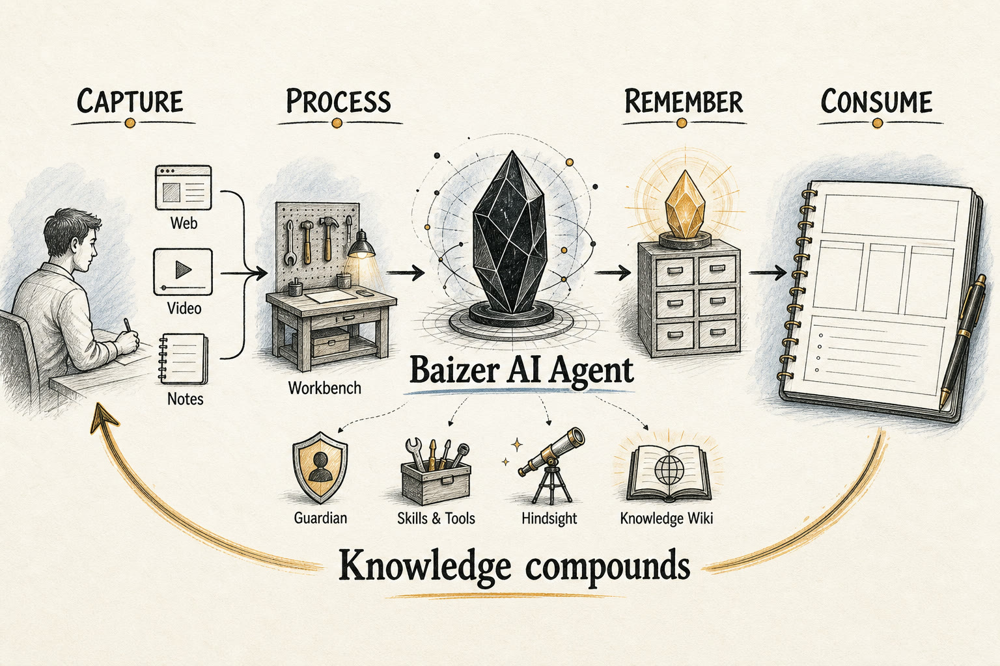

# Baizer

> English · [简体中文](./README.zh-CN.md)

Baizer is an AI knowledge workbench for Obsidian. Notes pile up faster than you can reuse them, AI chats start cold every time, and captured material rarely comes back into what you write next. Baizer connects those steps: information flows in, gets understood, becomes durable memory, and is fed back into later work. The name comes from Bai Ze, the mythic beast said to know the nature of all things.

## The pipeline: end to end

Baizer is not a chatbot bolted onto Obsidian. It is a single loop — **Capture → Process → Remember → Consume** — where every stage uses the same provider configuration and model handle, so knowledge compounds instead of piling up.

Capture brings material in; Process understands and reshapes it; Remember distils it into memory; Consume feeds both back into later work. Two edges close the loop: memory is recalled into the next prepared turn, and filed answers return to the Knowledge Wiki.

### 1. Capture — bring the world into the vault

Baizer ingests what you save and converts it into clean, structured notes.

- **Web and articles**: saves a page, isolates the article body, and writes clean Markdown with YAML frontmatter (`created`, `source`, `author`, `tags`), with dedicated handling for WeChat articles.
- **Video**: YouTube and Bilibili links resolve to their transcripts; when none exists, the audio is transcribed through your provider or the video metadata is summarized.
- **Live search**: searches the web (DuckDuckGo) when the answer isn't in the vault yet; the skill asks the model to cite the results.

### 2. Process — understand and reshape

Chat, selection edits, and Guardian run through the agent loop; compilation and summaries use one-shot generation from the same provider.

- **Workbench chat**: a streaming, tool-using agent that reads, writes, searches, and acts across the vault, with a foldable tool/thinking timeline.
- **Guardian**: an inline co-writer (Ghost Text) with a fast auto path and a deep path that escalates on dwell and pulls in knowledge-base context (off by default — enable it in Settings).
- **Selection actions**: select any text to Polish, Proofread, Translate, Expand, Summarize, or Explain — each with a preview before it touches the note.
- **Knowledge Wiki compilation**: chosen folders are compiled in batches against an ontology discovered from the notes themselves; changed notes are recompiled by content hash (requires choosing source folders). Compilation records each note's status (`knowledge_status`) in its frontmatter; the note body is never rewritten.

### 3. Remember — turn interactions into durable memory

Processing produces more than answers; it produces things worth keeping. Baizer's local memory store keeps them.

- **Three record types**: `world` (durable facts about you and your domain), `experience` (what worked or failed on past tasks), and `observation` (conclusions consolidated from other records, kept with evidence pointers).
- **Lessons from feedback**: a 👎 stores an `observation` with negative polarity, rendered in later prompts as "avoid this". A 👍 archives the answer to the Knowledge Wiki instead of writing a memory record.
- **Distilled, not dumped**: retention runs through the model to write reusable memories rather than raw transcripts. Only turns judged reusable are kept, and Privacy Mode turns retention off. A consolidator periodically merges and supersedes records.

### 4. Consume — feed memory back into everything

The loop closes here. Stored memory is injected into prompts, and compiled knowledge is looked up when a request needs it.

- **Relevance-ranked recall**: memories are scored with BM25 plus one-hop entity expansion, then injected into Workbench turns, Guardian's deep path, and the Polish / Expand / Explain selection actions.
- **Knowledge lookups**: `query_knowledge` retrieves compiled wiki articles; answers are instructed to cite them with `[[wikilink]]` sources.
- **File-back**: `/file-back` or a 👍 archives an answer into the Knowledge Wiki, so a good answer becomes a reusable source.
- **Context**: attach the current note, backlinks, recent notes, files, tags, selections, or images (where the provider supports it); the open note and its backlinks are also included automatically and labelled as possibly irrelevant.

## Product Surfaces

Four surfaces sit on top of the pipeline:

- **Workbench** — a chat-first sidebar for asking, searching, clipping, editing, running tools, and inspecting AI execution.
- **Guardian** — an editor-side assistant that suggests continuations and edits without pulling you out of the note.
- **Selection actions** — polish, proofread, translate, expand, summarize, or explain selected text with a preview.
- **Knowledge Wiki** — a compiler that turns chosen folders into structured, searchable pages Baizer can cite and reuse. Regeneration overwrites only articles Baizer wrote; a note you edited after compiling is reported, not overwritten.

Baizer speaks Obsidian's own language throughout — notes, wikilinks, frontmatter, backlinks, canvases, and bases — and adds its own explicit write permissions.

## Scope And Limits

- Single user, bring your own provider key. No hosted inference, accounts, or cloud sync.
- One vault at a time; nothing is ingested without a tool call or a command.
- Long jobs (folder compilation, deep Guardian) are bounded by your provider's context window and rate limits, and are billed by that provider.
- Mobile works, but batch compiles are slower and hotkeys depend on the device.

## Architecture Snapshot

The system is layered: **UI entry points → `ModelService` (facade) → pi runtime → Skills/Tools**, with Knowledge and Memory as side subsystems. All text and image inference runs through one runtime built on the `@earendil-works/pi-agent-core` agent harness, split between a stateful agent loop for chat and stateless one-shot calls for compilation, summaries, and completions. Audio transcription calls the provider's transcription endpoint directly.

> Going deeper: [`CLAUDE.md`](./CLAUDE.md) maps modules; [`docs/architecture/`](./docs/architecture/) covers the runtime, skills, permissions, and settings; [`CONTEXT.md`](./CONTEXT.md) defines the domain vocabulary.

## Tools And Skills

A tool is an action the model can invoke; a skill is a set of instructions it reads on demand through `read_skill`. This is the only tool inventory in this document.

- **Vault tools**: `read_note`, `create_note`, `update_note`, `append_to_note`, `delete_note`, `rename_note`, `list_notes`, `search_vault`, `open_file` (plus generic `read_file`/`create_file`/`update_file`).
- **Knowledge tools**: `query_knowledge`, `file_back_knowledge`.
- **External tools**: `save_webpage` (pages plus YouTube / Bilibili transcripts), `web_search` (DuckDuckGo).
- **Plugin control** (gated by `allowPluginControl`): `list_plugins`, `get_plugin_commands`, `get_plugin_settings`, `execute_plugin_command`. The same setting is required for generated plugin skills to exist.
- **Built-in skills**: `web-search`, `web-clipper`, `knowledge`, `plugin-ctrl`, `obsidian-markdown`, `json-canvas`, `obsidian-bases`. The last two generate `.canvas` and `.base` files.

## Slash Commands

Built-in commands:

- `/clear` — clear session history and start a fresh persistent session
- `/memory [overview|observations|search <query>|forget <world|experience|observation|all>]` — view, search, or forget memory (`/profile` and `/forget` still work as deprecated aliases)
- `/tools` — list available tools
- `/help` — command help
- `/new <title>` — create a note
- `/edit <instruction>` — AI-edit the selected text
- `/open <file>` — open a file by name
- `/file-back <message-id>` — archive a previous answer into the Knowledge Wiki
- `/wiki:compile [path]` / `/wiki:index` / `/wiki:lint` — compile / open index / health check

Skill-backed commands: `/save <url>` (web-clipper), `/wiki:query` (knowledge). These exist only when the corresponding skill is enabled. Type `@` for file autocomplete and `/` for command autocomplete.

## Permissions And Approvals

Two independent groups decide whether a write happens: what may be written
(`allowFileCreation`, `allowFileModification`, `allowPluginControl`) and where
(`vaultWriteScope`, `vaultWriteAllowedFolders`). Defaults: `all-vault` scope,
creation allowed, modification off, plugin control off, confirmations on.

`confirmExecutions` does not gate every write. It has two tiers:

- **Pre-approval** — `delete_note`, `rename_note`, and plugin control return an
  approval request; nothing executes until you approve the card.
- **Direct apply with undo** — `create_note`, `update_note`, `append_to_note`,
  and file creation/update apply immediately and are recorded as an undoable
  workspace edit. Reversibility, not a prompt, is the safeguard here.

AI-initiated writes into `.obsidian` are always blocked at the vault-tool layer;
Baizer's own operational storage there is managed internally. Knowledge
compilation is the one write outside the tool layer: it sets `knowledge_status`
in each source note's frontmatter. `allowPluginConfigValues` (default off)
additionally controls whether plugin setting values are returned. Selection
actions preview the replacement before it touches the note.

## Data Handling

**Baizer sends vault content out only when a feature needs a model or a network
resource.** There is no Baizer-operated server, no telemetry, and no analytics.

- **Model inference:** prompts go to the provider endpoint you configure. That
  includes notes, selections, recalled memory, prior turns, ambient context, and
  tool output. Video without a usable transcript is sent to that provider's
  transcription endpoint.
- **Retrieval and capture:** search queries go to DuckDuckGo; `save_webpage`
  fetches the URL you give it; video links resolve through YouTube or Bilibili;
  with plugin control enabled, plugin metadata is read from GitHub.
- **Your API keys** are stored unencrypted in the plugin's `data.json` inside
  your vault's `.obsidian` folder — the standard Obsidian plugin mechanism.
- **Privacy Mode** turns off automatic memory retention.

Review your provider's data-usage policy before pointing Baizer at sensitive
notes. [SECURITY.md](./SECURITY.md) lists every outbound destination.

## Local Storage

Everything Baizer stores lives inside the vault:

- `.obsidian/baizer*` — session transcripts, memory records, the audit log,
  generated and materialized skills, and scratch files. Drop a `.md` template
  into `.obsidian/baizer-commands/` to add your own slash command.
- `Knowledge Wiki/` (default) — compiled wiki articles. This is a normal,
  visible vault folder.

This data is unencrypted and is replicated by any vault sync or backup. To
remove it, delete those paths; uninstalling the plugin does not delete them.

## Supported Providers

- Google Gemini
- OpenAI-compatible providers, including OpenAI, DeepSeek, Qwen, and custom base URLs

Available capabilities (image input, custom base URL, thinking level) differ by backend; Settings → Baizer shows the options your provider supports. Changes take effect on the next turn.

## Installation

1. Download `main.js`, `manifest.json`, and `styles.css` from the [latest release](https://github.com/yinfi/baizer/releases/latest).
2. Copy them into `.obsidian/plugins/baizer/`.
3. Reload Obsidian and enable Baizer.

Requirements: Obsidian 1.7.2 or newer; a provider API key (usage is billed by that provider); Obsidian's Bases core plugin for the wiki index view.

First run: open Settings → Baizer, choose a provider and model, and paste the API key. Until then the Workbench opens but no request can complete.

Defaults: Workbench, selection actions, and memory work out of the box. Guardian is off until you enable it. The Knowledge Wiki compiles nothing until you choose source folders and run a compile.

## Development

Requires Node.js and npm. `npm install`, then `npm run dev` (watch build) or `npm run build`; `npm test` runs the tsx harness in `test/run-tests.ts`. See [CONTRIBUTING.md](./CONTRIBUTING.md) before opening a pull request.

## Platform Support

Baizer runs on desktop and mobile from one build. Differences are OS-level: available hotkeys, file pickers, and the speed of long batch compiles.

## Suggested Hotkeys

These are not bound by default. Assign them in Settings → Hotkeys:

- `Mod+J` — open Baizer
- `Mod+Shift+G` — Guardian manual trigger

## License

Released under the [MIT License](./LICENSE).
