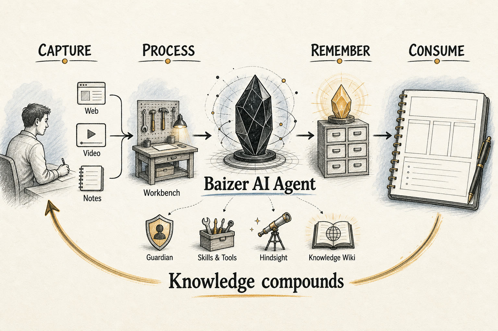

# Baizer

> [English](./README.md) · 简体中文

Baizer 是一个面向 Obsidian 的 AI 知识工作台。笔记越积越多，却越来越难复用；AI 对话每次都从零开始；采集来的材料很少再回到你正在写的东西里。Baizer 把这些环节连起来：信息流入、被理解、沉淀为可复用的记忆，再回流到后续的工作中。名字取自上古神兽「白泽」——传说中知天下万物之情。

## 主线：端到端

Baizer 不是在 Obsidian 上外挂一个聊天框。它是一条闭环——**采集 → 处理 → 记忆 → 消费**——每一环都使用同一套服务商配置与模型句柄，让知识不断复利，而不是越堆越多。

采集把材料带进来；处理理解并重塑它；记忆把它提炼为可复用的记忆；消费再把两者回流到后续工作。闭环有两条真实的边：记忆被召回进下一个准备好的回合，归档的答案回到知识库。

### 1. 采集 —— 把世界搬进 vault

Baizer 负责把你保存的内容整理成干净、结构化的笔记。

- **网页与文章**：抓取页面、剥离正文，写成带 YAML frontmatter（`created`、`source`、`author`、`tags`）的干净 Markdown，并对微信公众号文章做专门处理。
- **视频**：YouTube、Bilibili 链接会解析出转录；没有字幕时，音频会经你配置的服务商转写，或退化为视频元数据摘要。
- **实时搜索**：答案还不在库内时联网搜索（DuckDuckGo）；由技能要求模型引用检索结果。

### 2. 处理 —— 理解并重塑

对话、选区改写与 Guardian 走 agent 循环；编译与摘要使用同一服务商的一次性生成。

- **工作台对话**：一个流式、会用工具的 agent，能读写、搜索、跨 vault 行动，并带可折叠的工具/思考时间线。
- **Guardian**：行内协作写手（Ghost Text），快速自动路径 + 停顿后升级的深度路径，深度路径会引入知识库上下文（默认关闭，需在设置中开启）。
- **选区动作**：选中任意文字即可润色、校对、翻译、扩写、概括、解释——每个动作落笔前都先预览。
- **知识库编译**：选定的文件夹按从笔记本身发现的本体分批编译，内容哈希变化时重新编译（需先选择来源文件夹）。编译会把每篇笔记的状态（`knowledge_status`）写入其 frontmatter；笔记正文不会被改写。

### 3. 记忆 —— 把交互沉淀成可复用记忆

处理产出的不只是答案，还有值得留下的东西。Baizer 的本地记忆库会保存它们。

- **三类记录**：`world`（关于你和你领域的持久事实）、`experience`（过往任务的成败经验）、`observation`（从其它记录归纳出的结论，附带证据指针）。
- **反馈带来的教训**：👎 会写入一条负极性 `observation`，在后续 prompt 中渲染为「应避免」；👍 则把答案归档进知识库，而不是写入记忆记录。
- **提炼而非转储**：沉淀过程走模型，写成可复用的记忆而不是原始对话流水。只有被判定为可复用的回合才会保留；开启 Privacy Mode 会关闭自动沉淀。consolidator 会定期合并并替换旧记录。

### 4. 消费 —— 把记忆回流到一切生成中

闭环在这里合上。沉淀的记忆会注入 prompt，编译后的知识则在请求需要时被检索。

- **相关性排序召回**：记忆用 BM25 加一跳实体扩展打分，再注入工作台回合、Guardian 深路径，以及润色 / 扩写 / 解释三个选区动作。
- **知识检索**：`query_knowledge` 检索已编译的 wiki 文章；答案会被要求用 `[[wikilink]]` 标注来源。
- **回填归档**：`/file-back` 或 👍 会把答案归档进知识库，让一个好答案成为可复用的来源。
- **上下文**：附加当前笔记、反链、近期笔记、文件、标签、选区或图片（取决于服务商是否支持）；打开的笔记与其反链也会自动加入，并标注为可能不相关。

## 产品形态

四个界面架在这条流水线之上：

- **工作台（Workbench）**——以对话为中心的侧边栏，用于提问、搜索、剪藏、编辑、跑工具、检视 AI 执行过程。
- **Guardian**——编辑器一侧的助手，在不打断你写作的前提下建议续写与改写。
- **选区动作**——对选中文本做润色、校对、翻译、扩写、概括或解释，落笔前先预览。
- **知识库（Knowledge Wiki）**——把选定文件夹编译成结构化、可检索页面的编译器，Baizer 可引用并复用。再生成只覆盖 Baizer 写的文章；编译后你手动改过的笔记会被报告，而不会被覆盖。

整条链路都说 Obsidian 自己的语言——笔记、wikilink、frontmatter、反链、canvas、base——并在此基础上加入自己的显式写入权限。

## 范围与限制

- 单用户、自带服务商密钥；没有托管推理、账号或云同步。
- 同一时间只服务一个库；没有工具调用或命令，就不会摄取任何内容。
- 长任务（文件夹编译、深度 Guardian）受服务商上下文窗口与速率限制约束，并由服务商计费。
- 移动端可用，但批量编译更慢，快捷键取决于设备。

## 架构速览

系统分层：**UI 入口 → `ModelService`（门面）→ pi 运行时 → 技能/工具**，知识与记忆作为旁路子系统。所有文本与图片推理都走同一套基于 `@earendil-works/pi-agent-core` agent harness 的运行时，分为用于对话的有状态 agent 循环，以及用于编译、摘要与补全的无状态一次性调用。音频转写直接调用服务商的转写端点。

> 想读更深：[`CLAUDE.md`](./CLAUDE.md) 是模块地图；[`docs/architecture/`](./docs/architecture/) 讲运行时、技能、权限与配置；[`CONTEXT.md`](./CONTEXT.md) 定义领域术语。

## 工具与技能

工具（Tool）是可被模型调用的动作；技能（Skill）是模型按需通过 `read_skill` 读取的一组指令。本文档只在这里列一份工具清单。

- **Vault 工具**：`read_note`、`create_note`、`update_note`、`append_to_note`、`delete_note`、`rename_note`、`list_notes`、`search_vault`、`open_file`（另有通用 `read_file`/`create_file`/`update_file`）。
- **知识工具**：`query_knowledge`、`file_back_knowledge`。
- **外部工具**：`save_webpage`（网页，以及 YouTube / Bilibili 转录）、`web_search`（DuckDuckGo）。
- **插件控制**（受 `allowPluginControl` 管控）：`list_plugins`、`get_plugin_commands`、`get_plugin_settings`、`execute_plugin_command`。同一设置也是生成插件技能存在的前提。
- **内置技能**：`web-search`、`web-clipper`、`knowledge`、`plugin-ctrl`、`obsidian-markdown`、`json-canvas`、`obsidian-bases`。后两者生成 `.canvas` / `.base` 文件。

## 斜杠命令

内置命令：

- `/clear` —— 清空会话历史并开启新的持久化会话
- `/memory [overview|observations|search <query>|forget <world|experience|observation|all>]` —— 查看/搜索/遗忘记忆（`/profile` 与 `/forget` 仍可用，但已弃用）
- `/tools` —— 列出可用工具
- `/help` —— 命令帮助
- `/new <title>` —— 新建笔记
- `/edit <instruction>` —— AI 编辑选中文本
- `/open <file>` —— 按名打开文件
- `/file-back <message-id>` —— 把某条历史答案归档进知识库
- `/wiki:compile [path]` / `/wiki:index` / `/wiki:lint` —— 编译 / 打开索引 / 健康检查

技能命令：`/save <url>`（web-clipper）、`/wiki:query`（knowledge）。仅当对应技能启用时才存在。输入 `@` 补全文件，`/` 补全命令。

## 权限与审批

是否发生一次写入，由两组独立设置决定：能写什么（`allowFileCreation`、`allowFileModification`、`allowPluginControl`）与能写哪里（`vaultWriteScope`、`vaultWriteAllowedFolders`）。默认值：作用域 `all-vault`、允许创建、禁止修改、插件控制关闭、确认开启。

`confirmExecutions` 并不会拦截所有写入。它分两层：

- **预审批**——`delete_note`、`rename_note` 与插件控制会返回审批请求；你批准卡片之前不会执行。
- **直接应用 + 撤销**——`create_note`、`update_note`、`append_to_note` 以及文件创建/更新会立即生效，并记录为可撤销的 workspace edit。这里的保障是可逆性，而不是弹窗。

AI 发起的 `.obsidian` 写入始终在库工具层被阻止；Baizer 自己在该目录下的运行数据由内部管理。知识编译是工具层之外唯一的写入：它会把 `knowledge_status` 写入每篇源笔记的 frontmatter。`allowPluginConfigValues`（默认关闭）额外控制是否返回插件设置值。选区动作会在落笔前预览替换内容。

## 数据处理

**只有当某项功能需要模型或网络资源时，Baizer 才会把库内容发出去。** 没有 Baizer 运营的服务器，没有遥测，也没有统计分析。

- **模型推理**：prompt 会发往你配置的服务商端点，其中包括笔记、选中文本、召回的记忆、历史回合、环境上下文与工具返回内容。没有可用转录的视频会发往该服务商的转写端点。
- **检索与采集**：搜索词会发往 DuckDuckGo；`save_webpage` 会访问你提供的 URL；视频链接会经 YouTube 或 Bilibili 解析；启用插件控制时，插件元数据会从 GitHub 读取。
- **你的 API 密钥**以未加密形式存放在库内 `.obsidian` 目录下插件自己的 `data.json` 中——这是 Obsidian 插件的标准机制。
- **Privacy Mode** 会关闭自动记忆沉淀。

在让 Baizer 处理敏感笔记之前，请先了解你所用服务商的数据使用政策。[SECURITY.md](./SECURITY.md) 列出了每一处出站目标。

## 本地存储

Baizer 保存的所有内容都在库内：

- `.obsidian/baizer*` —— 会话记录、记忆记录、审计日志、生成与物化的技能，以及临时文件。往 `.obsidian/baizer-commands/` 丢一个 `.md` 模板，就能增加一条自己的斜杠命令。
- `Knowledge Wiki/`（默认）—— 编译后的 wiki 文章。这是一个正常、可见的库内文件夹。

这些数据未加密，并且会被任何库同步或备份复制。要删除它们，直接删除以上路径；卸载插件不会删除这些数据。

## 支持的 Provider

- Google Gemini
- OpenAI 兼容 provider，包括 OpenAI、DeepSeek、Qwen 及自定义 base URL

可用能力（图片输入、自定义 base URL、思考等级）因后端而异；Settings → Baizer 会显示你的服务商支持的选项。更改在下一轮生效。

## 安装

1. 从 [最新版本](https://github.com/yinfi/baizer/releases/latest) 下载 `main.js`、`manifest.json` 和 `styles.css`。
2. 把它们复制到 `.obsidian/plugins/baizer/`。
3. 重载 Obsidian 并启用 Baizer。

前提：Obsidian 1.7.2 或更新版本；一个服务商 API 密钥（用量由该服务商计费）；知识库索引视图需要 Obsidian 的 Bases 核心插件。

首次运行：打开 Settings → Baizer，选择服务商与模型，粘贴 API 密钥。在此之前工作台可以打开，但任何请求都无法完成。

默认状态：工作台、选区动作与记忆开箱可用；Guardian 需在设置中开启；知识库在你选择来源文件夹并运行编译之前不会编译任何内容。

## 开发

需要 Node.js 与 npm。先 `npm install`，然后 `npm run dev`（监听构建）或 `npm run build`；`npm test` 运行 `test/run-tests.ts` 中的 tsx harness。提交 PR 前请先看 [CONTRIBUTING.md](./CONTRIBUTING.md)。

## 平台支持

Baizer 用同一份构建运行在桌面端与移动端。差异只来自系统层面：可用快捷键、文件选择器，以及长时间批量编译的速度。

## 建议快捷键

以下快捷键默认未绑定，请在 Settings → Hotkeys 中自行分配：

- `Mod+J` —— 打开 Baizer
- `Mod+Shift+G` —— Guardian 手动触发

## 许可证

基于 [MIT License](./LICENSE) 发布。
