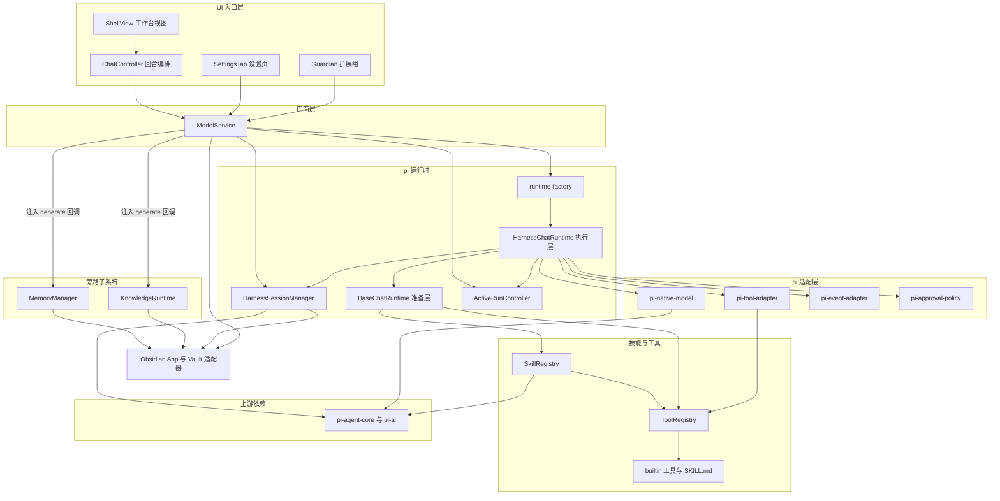
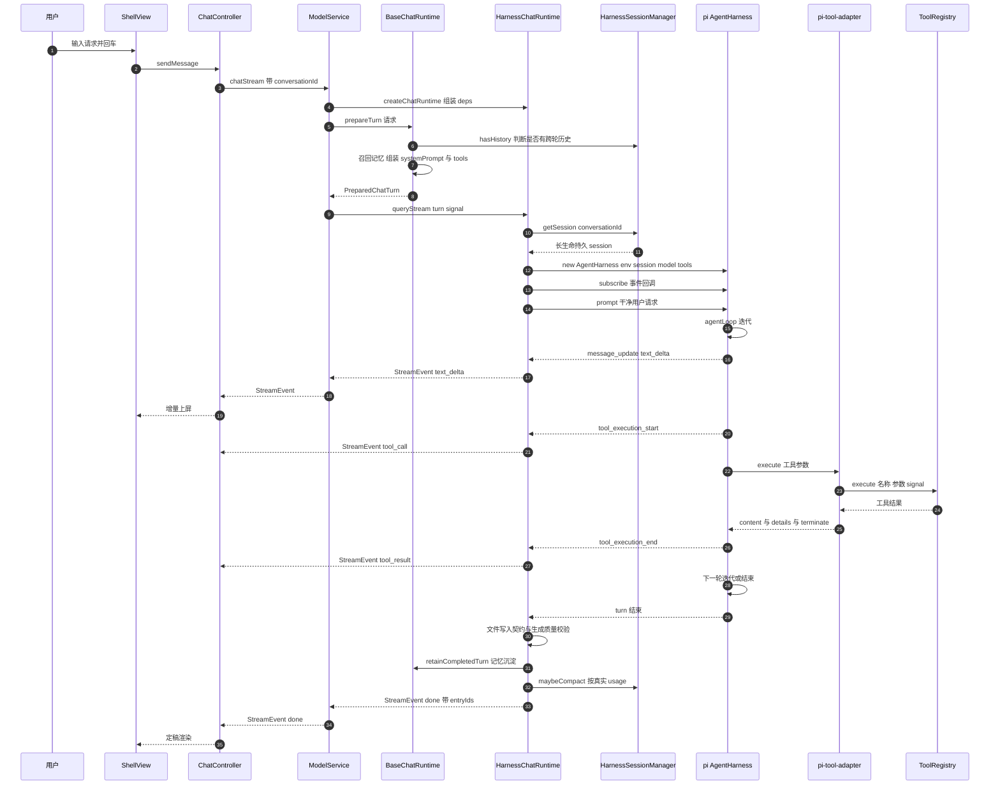
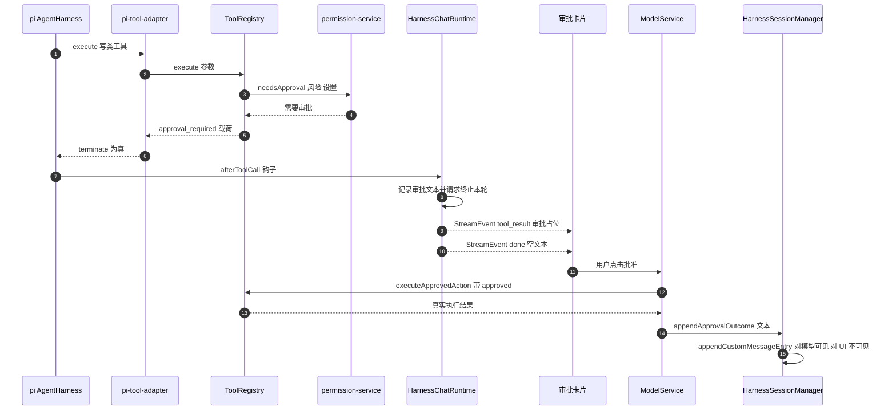
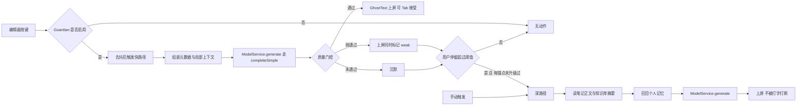
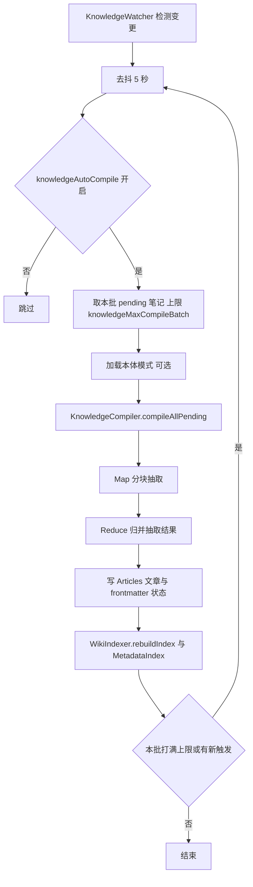

# 系统架构 — Baizer（obsidian-cli）

## 1. 系统总览

Baizer 是一个**单体 Obsidian 插件**（无服务端、无微服务、无数据库）。全部能力在单个 JS bundle 内运行于 Obsidian 的渲染进程；持久化一律落在 vault 内的隐藏目录（`.obsidian/baizer-*`），移动端与桌面端共用同一份代码路径。

架构分层为：

```
UI 入口层  →  ModelService 门面  →  pi 运行时  →  技能 / 工具
                                        |
                      知识子系统 / 记忆子系统（旁路，经门面回调接入 LLM）
```

设计的第一性约束是**单一 LLM 运行时**：所有推理——会话型（有工具、有历史、有 steering）与无状态型（编译、摘要、补全）——都经 `@earendil-works/pi-agent-core` 与 `@earendil-works/pi-ai` 走同一套 `ProviderConfig → pi Model` 映射。历史遗留的 per-provider 适配层已全部删除。

## 2. 架构风格

**证据**：单一 `package.json`、单入口 `main.ts`、单 bundle 输出、无网络服务端、无进程间边界。

- **风格判定**：分层单体（Layered Monolith），运行在宿主应用的插件沙箱内
- **模块化手段**：按领域分包（`runtime` / `services` / `skills` / `knowledge` / `memory` / `ui` / `permissions` / `mcp` / `i18n` / `utils`），以 TypeScript 接口而非运行期容器解耦
- **扩展点**：工具注册表 + 技能注册表（运行期注册，模型经 `read_skill` 渐进式发现）；`ProviderConfig` 映射（新增 provider 只改一个映射文件）
- **不采用的风格**：无微服务、无事件总线、无 DI 容器、无 ORM

## 3. 组件关系



<!-- Text fallback: UI 入口层（ShellView / ChatController / Guardian 扩展组 / SettingsTab）调用门面 ModelService。ModelService 经 runtime-factory 构造 HarnessChatRuntime（继承 BaseChatRuntime）。HarnessChatRuntime 使用 pi 适配层四件（pi-native-model / pi-tool-adapter / pi-event-adapter / pi-approval-policy），并复用 HarnessSessionManager 的持久会话与 ActiveRunController 的运行中控制。BaseChatRuntime 依赖 SkillRegistry 与 ToolRegistry 装配提示与工具集；pi-tool-adapter 经 ToolRegistry 执行工具，ToolRegistry 持有 builtin 工具。ModelService 向 KnowledgeRuntime 与 MemoryManager 注入无状态 generate 回调（避免反向依赖）。pi-native-model、HarnessSessionManager、SkillRegistry 直接依赖上游 pi 包。ModelService、HarnessSessionManager、KnowledgeRuntime、MemoryManager 经 Obsidian vault 适配器落盘。 -->

## 4. 两条 LLM 路径

| 路径 | 底层 pi API | 用途 | 特性 |
|---|---|---|---|
| **会话型** | `AgentHarness`（内部驱动 agentLoop） | Workbench 聊天、技能指令执行 | 工具、跨轮历史、steering、审批终止、自动压缩 |
| **无状态型** | `completeSimple` | 知识编译、会话摘要、Guardian 补全、记忆提炼、模型探活 | 无工具、无历史，纯 `prompt → text` |

两条路径由**同一个** `ProviderConfig` 构造模型（`ModelService.buildNativeChatHandle` 与 `buildNativeCompleteFn` 各自调用 `buildGeminiModel` / `buildOpenAICompatModel`），因此设置变更（provider / model / key / contextWindow / thinkingLevel）在**下一轮**自动生效——模型句柄每轮重建。

## 5. 数据流

### 5.1 会话型（Workbench 一轮对话）

1. UI 调 `ModelService.chatStream(...)`
2. `ModelService.createChatRuntime()` → `createChatRuntime()` 恒返回 `HarnessChatRuntime`
3. `BaseChatRuntime.prepareTurn()` 组装本轮：
   - 记忆召回（`recallForPrompt`）与用户画像（`getMentalModelBlock`）并行取
   - 当前时间、上下文项、选区
   - skill 清单（pi `formatSkillsForSystemPrompt`）与 `[Skill Access]` 说明
   - slash 命令契约（本地命令 + 技能命令 + 用户自定义命令，去重）
   - 生成计划（`GenerationStrategyService`）与文件操作契约
   - **装饰进 `systemPrompt`（每轮发送、不持久化）；干净的 `userMessage` 作为 `prompt`**
4. `HarnessChatRuntime.queryStream()` 取该会话的持久 session，构造 `AgentHarness`，后台驱动 `harness.prompt()`
5. pi 事件 → `mapPiEventToStreamEvent` → 内部异步队列 → `StreamEvent` 产出给 UI
6. 工具调用经 `pi-tool-adapter` 落到 `ToolRegistry.execute()`
7. 完成后：文件写入契约校验 → 生成质量校验 → 记忆沉淀 → 提取本轮 entryId → 按真实 usage 触发 `maybeCompact`

### 5.2 无状态型（知识编译 / 摘要 / 补全）

`调用方 → ModelService.generate(prompt, systemPrompt, options) → buildNativeCompleteFn() → pi completeSimple → 抽出 text 块拼接返回`

调用方包括：`KnowledgeCompiler`（编译）、`GuardianCompletionService`（补全）、`MemoryManager` / `HindsightConsolidator`（提炼）、`PluginSkillGenerator`（生成插件技能）、`VideoTranscription`（视频摘要）、`ModelCatalogService`（探活）。

### 5.3 跨轮上下文的唯一真相源

**`SessionStore`（现为 `HarnessSessionManager` + pi JSONL session）是唯一真相源。** 有持久会话时，历史由 pi 从 session 派生（经压缩视图），UI 的 `priorMessages` 被**忽略**——UI 退化为纯渲染。无持久会话（如后台一次性调用）时无跨轮上下文。

## 6. 关键设计决策

| 决策 | 理由（代码内注释给出的） | 落点 |
|---|---|---|
| 准备与执行分离（`BaseChatRuntime` / `HarnessChatRuntime`） | 把约 250 行提示装配从循环驱动器里拿出来，两半可各自单测 | `docs/architecture/runtime.md` |
| 装饰进 `systemPrompt`、原文进 `prompt` | 跨轮历史保持干净；harness.prompt() 持久化的是纯用户请求 | `src/runtime/runtime-types.ts:124-134` |
| 无 `use_skill` 元工具，改用 `read_skill` | 渐进式披露：完整指令不进提示，除非模型主动拉取 | `docs/architecture/runtime.md`；`src/runtime/base-chat-runtime.ts:331` |
| 关键词命中降级为一行提示 | 猜错的代价是一行浪费的 prompt，而非一轮做不完的对话 | `docs/adr/0002-keyword-matches-never-narrow-the-tool-set.md` |
| Steering 交给 pi 原生 `steer()` / `setActiveTools()` | 旧 `SteeringController` 的 FIFO 队列 + `prepareNextTurn` 钩子是在底层重造 harness 已有能力 | `src/runtime/active-run-controller.ts:12-26` |
| per-conversation 会话隔离（`conversationId` = tab.id） | 修掉旧版"多 tab 共享单 session 串台" | `src/runtime/pi/harness-session-manager.ts:103-109` |
| 分支操作走 `session.moveTo` + 重投影，不用 `navigateTree` | 核心原语是 leaf 移动 + `projectBranchToMessages` | `src/runtime/pi/harness-session-manager.ts:309-366` |
| 审批结果用 `appendCustomMessageEntry` 回灌 session | 原 tool_call 已有配对占位 toolResult，不能给第二个结果；custom_message 对模型可见、对 UI 分支投影不可见 | `src/runtime/pi/harness-session-manager.ts:278-292` |
| 权限决策收敛为纯函数 | 三步检查（scope / capability / approval）此前在 6 个工具里逐字重复 | `src/permissions/permission-service.ts:1-11` |
| 内置 skill 物化写盘移出 `onload` | 移动端 7 个文件串行写盘过 native 桥，阻塞启动数百毫秒 | `main.ts:155-158`；`src/skills/skill-registry.ts:119-126` |
| 存根掉未使用的 pi provider | pi-ai 为 9 个 provider 注册惰性加载器，esbuild CJS 无 code splitting 会全部内联；Mistral SDK 1.2 MB 是纯死重 | `esbuild.config.mjs:23-43` |
| 所有 pi 值导入走动态 `import()` | pi 是 ESM-only，bundle 是 CJS、测试是 commonjs | `src/runtime/pi/pi-native-model.ts:14-16` |

## 7. 交互图（Interaction Diagrams）

### 7.1 一轮带工具调用的 Workbench 对话



<!-- Text fallback: 用户输入经 ShellView → ChatController → ModelService.chatStream。ModelService 建 HarnessChatRuntime 并先跑 BaseChatRuntime.prepareTurn（查会话历史、召回记忆、组装 systemPrompt 与 tools），再调 queryStream。queryStream 从 HarnessSessionManager 取该会话的长生命持久 session，构造 pi AgentHarness 并 subscribe 事件，随后后台驱动 harness.prompt(干净用户请求)。pi 的 message_update 事件映射成 text_delta 增量上屏；tool_execution_start/end 映射成 tool_call/tool_result，工具实际执行经 pi-tool-adapter 落到 ToolRegistry。结束后 HCR 做文件写入契约与生成质量校验、触发记忆沉淀、按真实 usage 调 maybeCompact，最后产出 done 事件并附本轮 entryId。 -->

### 7.2 审批中断与批准回灌



<!-- Text fallback: 写类工具执行时先经 permission-service.needsApproval 判定，需审批则返回 approval_required 载荷，pi-tool-adapter 把 terminate 置真。HarnessChatRuntime 的 afterToolCall 钩子记录审批文本并结束本轮，UI 收到审批占位 tool_result 与空文本 done。用户点批准后，ModelService.executeApprovedAction 带 approved 直执工具，再用 HarnessSessionManager.appendApprovalOutcome 把执行结果作为 custom_message 条目回灌 session——对模型可见（下一轮不失忆），对 UI 分支投影不可见（不渲染假气泡）。 -->

### 7.3 Guardian 双路径补全



<!-- Text fallback: 编辑器按键后，若 Guardian 启用则去抖触发快路径：组装元数据与局部上下文，经 ModelService.generate 走 pi completeSimple，再过质量门控——通过则 GhostText 上屏可 Tab 接受，弱通过则上屏并标记 weak，未通过则沉默。无论"沉默"还是"弱通过"，只要用户停留超过阈值且该锚点未升级过，就升级到深路径；深路径也可由手动触发。深路径读笔记正文与知识库摘要、召回个人记忆后再生成，且不被打字打断。 -->

### 7.4 知识编译（Map-Reduce）



<!-- Text fallback: KnowledgeWatcher 检测到源文件夹变更后去抖 5 秒；若开启自动编译，则取本批 pending 笔记（受 knowledgeMaxCompileBatch 限制），可选加载本体模式，交给 KnowledgeCompiler.compileAllPending。编译先 Map 分块抽取、再 Reduce 归并，写出 Articles 文章与 frontmatter 状态，然后 WikiIndexer 与 MetadataIndex 重建索引。若本批打满上限或运行期间有新触发，则再走一次去抖补跑（成功项转 done、失败项转 failed，pending 严格递减，不会无限循环）。 -->

## 8. 改进机会（架构层面，非本阶段结论）

- **pi 类型面未被使用**：`AgentHarness`、session repo 均以 `as any` 构造，`harnessEnv` 类型为 `unknown`，pi 会话 API 被手抄成本地结构接口。类型检查器对上游变更零感知。
- **`StreamEvent` 比 pi 事件模型更窄**：只映射 4 类 pi 事件，压缩 / usage / 审批原生信号等被丢弃。
- **巨型文件**：`settings.ts` 2786 行、`shell-view.ts` 2203 行、`chat-controller.ts` 1210 行，均超过本仓 CLAUDE.md 自定的 500 行约定。
- **构建脆点**：pi provider 存根依赖 pi-ai `providers/` 下的相对文件名正则，上游改名即静默失效。
- **文档漂移**：`docs/architecture/runtime.md` 仍指向已删除的 `src/runtime/steering-controller.ts`。

## 9. 相关文件

- 引导：`main.ts`
- 门面：`src/services/model-service.ts`
- 运行时：`src/runtime/runtime-factory.ts`、`runtime-types.ts`、`base-chat-runtime.ts`、`src/runtime/pi/*`
- 技能：`src/skills/skill-registry.ts`、`tool-registry.ts`、`skill-files.ts`、`pi-skill-source.ts`
- 权限：`src/permissions/permission-service.ts`
- 旁路：`src/knowledge/runtime.ts`、`src/memory/memory-manager.ts`
