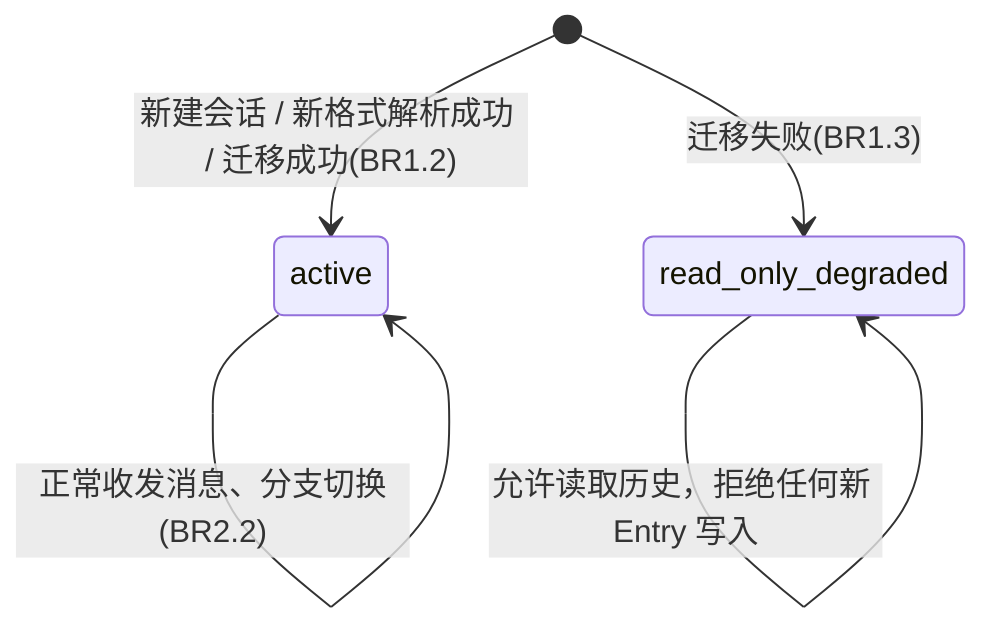
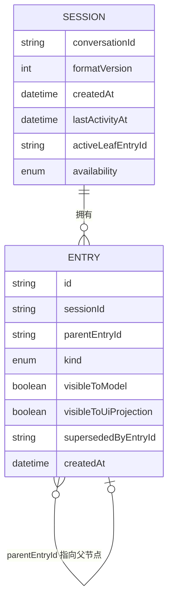

# 行为规范 —— pi 运行时底座重构

来源：`requirements.md` FR1-FR5；`entities.md`；`rules.md`；`functional-design-questions.md` 全部回答。

## 1. 工作流：会话文件打开（含迁移判定）

对应 BR1.1/BR1.2/BR1.3。

```
1. 用户打开/恢复一个 Session（conversationId = tab id）
2. 读取该 Session 对应的 vault 内会话文件
3. 按 BR1.1 判定文件格式：
   3a. 新格式特征匹配 → 直接解析为 Session + Entry[]，Session.availability = active，结束（无迁移）
   3b. 旧格式特征匹配 → 进入步骤 4（迁移）
   3c. 两者皆不匹配 → 进入步骤 6（迁移失败）
4. 按 BR1.2 执行迁移：
   4a. 解析旧格式的全部条目，重建为 Entry 树
   4b. 识别现有审批回灌条目（旧的 custom_message 用法），改写为 kind = approval_outcome
   4c. 写出新格式文件（覆盖或并行写，具体落地方式留给 Code Generation 阶段决定，但写出结果必须通过 BR1.1 的新格式特征判定）
   4d. Session.formatVersion 置为当前版本号；Session.availability = active
5. 迁移成功，结束（用户无感：对话可以继续）
6. 按 BR1.3 处理迁移失败：
   6a. Session.availability = read_only_degraded
   6b. 保留原文件，不做任何写入或删除
   6c. UI 显示明确提示（该会话仅可查看历史，不能继续对话）
   6d. 结束（不影响其他 Session 的步骤 1-5）
```

### 状态机：Session.availability



<!-- Text fallback: Session 的 availability 状态机只有两个状态。初始路径 1：新建会话或新格式文件直接解析成功，进入 active；在 active 态可以正常收发消息与切换分支，且保持在 active。初始路径 2：旧格式文件迁移失败，直接进入 read_only_degraded；该状态是终态，允许读取历史但拒绝任何新 Entry 的写入，不会自动恢复为 active。 -->

## 2. 工作流：分叉/重试/编辑/兄弟切换

对应 BR2.2；实现现有 `moveTo` + `projectBranchToMessages` 的既有用户可见行为（来源：CodeKB `architecture.md` 关键设计决策表"分支操作走 session.moveTo + 重投影，不用 navigateTree"）。

```
1. 用户在某条已有 Entry（称为 E）上执行 编辑 / 重试
2. 创建新 Entry E'：
   - E'.parentEntryId = E.parentEntryId（与 E 是兄弟，而不是 E 的子节点）
   - E'.payload = 用户编辑后的内容 / 重试后的新生成内容
3. 更新 E.supersededByEntryId = E'.id（原条目标记为已被取代，但不删除、不改写 payload）
4. Session.activeLeafEntryId 更新为从 E' 出发的新分支叶子
5. 读取该 Session 时，投影算法从 Session.activeLeafEntryId 回溯到根，
   只收集这条路径上的 Entry（过滤掉未被 activeLeafEntryId 路径经过的兄弟分支）
6. 结束：用户看到的对话历史是新分支的内容；旧分支的 Entry 仍保留在存储中，
   可通过"兄弟切换"操作（只改写 activeLeafEntryId，不触发步骤 2-3）重新激活
```

## 3. 工作流：审批中断与回灌

对应 BR2.1；实现现有"对模型可见、对 UI 分支投影不可见"的既有行为（来源：CodeKB `architecture.md` §7.2 交互图）。

```
1. 工具调用需要审批（permission-service 判定 needsApproval）时，
   本轮结束，产生一条 tool_call Entry（visibleToModel = true, visibleToUiProjection = true）
   与一条占位的 tool_result Entry（表示"待审批"）
2. 用户在审批卡片上点击批准/拒绝
3. 实际执行工具（或跳过），得到真实结果
4. 写入一条新 Entry：kind = approval_outcome，
   visibleToModel = true（固定）、visibleToUiProjection = false（固定，来源 BR2.1）
5. 结束：下一轮模型请求的历史里包含这条 approval_outcome Entry（模型"记得"审批结果），
   但 UI 渲染的消息列表里不出现它（不会多出一个奇怪的气泡）
```

## 4. 决策表：pi 1.x 事件类型 → StreamEvent 处理方式

对应 BR3.1（来源：Q4 答案 A）。本表是 FR3.3 的验收依据；Code Generation 阶段必须让每一行"映射"类型都有对应的可观察 `StreamEvent` 产出路径，每一行"丢弃"类型都在代码中有对应注释指回本表的理由列。

> 本表以 1.x `Agent`（`agent.d.ts`）暴露的事件家族为基础列出；具体事件负载字段由 Code Generation 阶段读取 1.x 类型定义核实后填充，此处先确定"映射 vs 丢弃"的决策与理由，不预先固定字段名。

| pi 1.x 事件类型（家族） | 现状（0.75.5→4 类映射） | 决策 | 映射到 / 丢弃理由 |
|---|---|---|---|
| 文本增量（message/text delta） | 已映射 | 映射 | → `StreamEvent.text_delta`（延续现状） |
| 工具调用开始/结束 | 已映射 | 映射 | → `StreamEvent.tool_call` / `tool_result`（延续现状） |
| 回合结束（turn/done） | 已映射 | 映射 | → `StreamEvent.done`（延续现状，含 entryId 锚定） |
| 错误/异常事件 | 已映射（现状 4 类之一，具体归类待 Code Generation 核实） | 映射 | → 现有错误处理路径对应的 `StreamEvent` 变体 |
| 会话压缩相关事件（compaction） | 现状被丢弃（CodeKB `architecture.md` §8"改进机会"记录为既有观察） | 映射 | → 新增一个 `StreamEvent` 字段/变体，使 UI 可感知压缩发生（具体字段形状由 Code Generation 阶段设计），不再是纯内部副作用 |
| usage/token 用量事件 | 现状被丢弃 | 丢弃 | 理由：Baizer 当前 UI 不展示逐轮 token 用量，且 `maybeCompact` 走的是独立的用量估算路径（非依赖该事件），拓展为用户可见功能超出本次重构范围（FR5 范围外：不新增功能） |
| 审批/权限原生信号（若 1.x 暴露专用事件而非仅工具执行回调） | 现状被丢弃 | 映射 | → 延续本规范"工作流 3"的审批回灌路径；若 1.x 把审批信号并入工具执行回调（`beforeToolCall`/`afterToolCall`）而非独立事件，则该行降级为"不适用"，由 Code Generation 阶段核实后在代码注释中注明 |

## 5. 派生视图：实体关系图（源自 entities.md）



<!-- Text fallback: Session 与 Entry 是一对多关系（一个 Session 拥有多个 Entry）。Entry 通过 parentEntryId 字段自引用，指向同一 Session 内的父 Entry，构成分叉树。Session 的字段含 conversationId、formatVersion、createdAt、lastActivityAt、activeLeafEntryId、availability。Entry 的字段含 id、sessionId、parentEntryId、kind、visibleToModel、visibleToUiProjection、supersededByEntryId、createdAt。 -->

## 6. 派生视图：业务规则摘要（源自 rules.md）

| 规则 ID | 类别 | 一句话 |
|---|---|---|
| BR1.1 | validation | 会话文件新旧格式按内容特征判定 |
| BR1.2 | policy | 旧格式会话首次打开时自动迁移，行为保真度等价 |
| BR1.3 | policy | 迁移失败则只读保护，不影响其他会话 |
| BR2.1 | constraint | Entry 可见性由两个独立维度决定；审批回灌固定"模型可见、UI 不可见" |
| BR2.2 | constraint | 分支切换只改写指针，不改写既有 Entry 内容 |
| BR3.1 | constraint | pi 1.x 事件类型必须逐一"映射"或"丢弃+理由"，不允许静默丢弃 |
