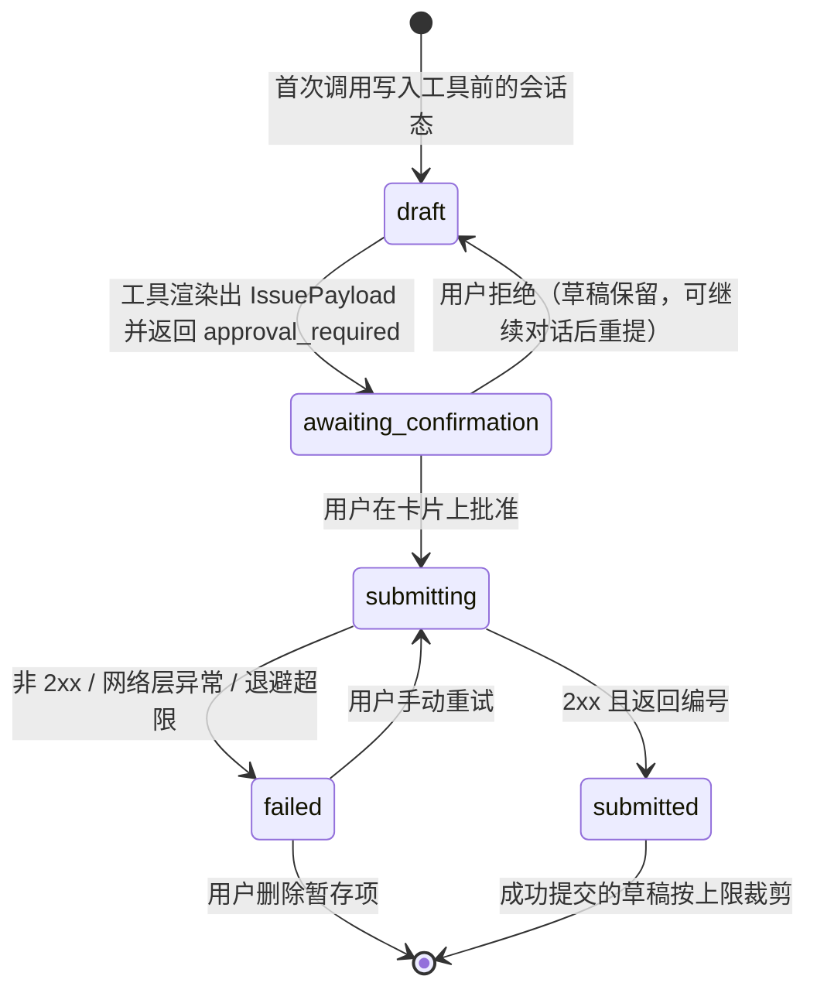
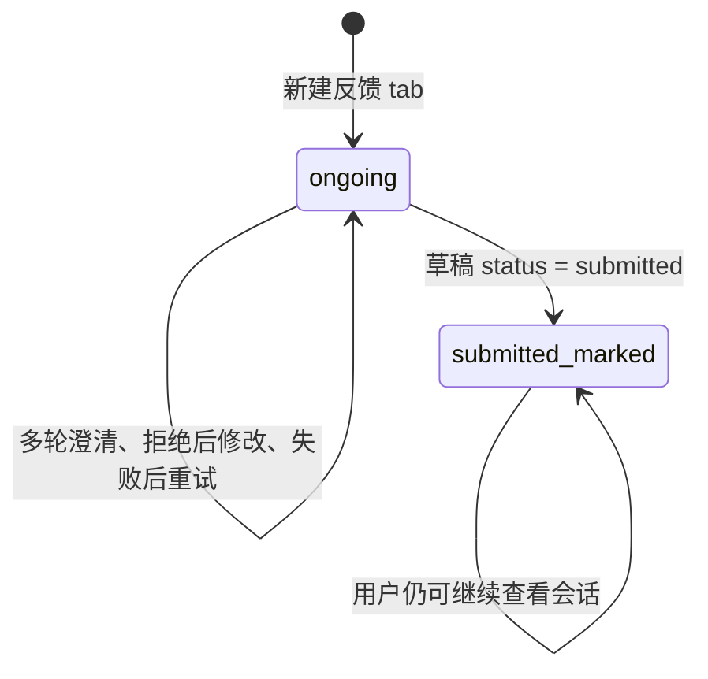
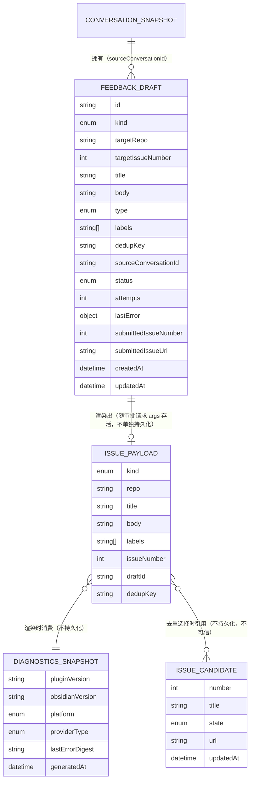

# 行为规范 —— 对话式反馈：与智能体澄清后提交 GitHub Issue

来源：`requirements.md` FR1–FR6 / NFR1–NFR8；`entities.md`；`rules.md`；`functional-design-questions.md`。

本文件是**工作流与状态机的事实来源**（`entities.md` 管数据形状，`rules.md` 管判定逻辑，二者都不表达有序行为与状态迁移）。第 8、9 节是从 `entities.md` 与 `rules.md` 派生的可读视图，不是事实来源。

## 1. 工作流：发起反馈会话

对应 BR1.1 / BR1.2 / BR1.4 / BR1.5。

```
1. 用户在 Workbench 头部点反馈按钮，或在任意界面执行命令 baizer:feedback
2. 新建一个反馈 tab（TabManager.createTab），并在标签栏上以可区分的标题/图标标识它
3. 把该 tab 的 id 作为 conversationId，标记为反馈会话
4. 该会话的每一轮都以 turnOptions = { isolatedContext: true, forcedSkillName: 'feedback' }
   发起 chatStream
5. 首轮若检测到内置凭据为空 → 走工作流 7（凭据缺失），不进入澄清
6. 否则进入工作流 2（澄清对话）
7. 结束：用户看到一条可多轮继续的对话，与普通对话的交互体验一致（流式渲染、
   工具时间线、审批卡片、跨重启恢复全部复用）
```

## 2. 工作流：澄清对话

对应 BR1.1 / BR1.2 / BR2.1 / BR2.2 / BR2.3 / BR7.4。

```
1. 用户用自己的话描述问题
2. 智能体按最少轮次原则判断还缺哪些必问字段
   （问题类型 / 现象 / 期望行为 / 复现步骤 / 影响范围 / 是否已尝试绕过）
   2a. 能从对话历史或已有信息推断的字段 → 不再追问，直接采用推断值
   2b. 用户表达「直接提交」「不用再问了」或等价措辞 → 立即跳到步骤 5
3. 需要判断是否已知问题时，调用 search_github_issues
   3a. 返回候选 → 展示候选列表（编号/标题/状态/链接），等待用户选择
       - 用户选「追加评论到已有 issue」 → 草稿 kind = issue_comment，targetIssueNumber = 该编号
       - 用户选「仍然新建」             → 草稿 kind = new_issue
       - 用户未表态                     → 不替用户判定，继续对话
   3b. 检索触限 → 跳过去重并明示「未做重复检查」，继续澄清（BR5.2）
   3c. 无候选 → 草稿 kind = new_issue
4. 澄清过程中若识别出安全漏洞 → 跳出本流程，走工作流 6
5. 字段齐备（或用户要求直接提交）→ 调用 get_plugin_diagnostics 取诊断信息
6. 进入工作流 3（草稿生成与确认）
```

**外部内容的处理**（BR7.4）：`search_github_issues` 的返回只映射为 `IssueCandidate` 的结构化字段；候选标题作为**外部数据**渲染，单行化、截断 200 字符、剔除控制字符，且不解析其中任何形似指令的内容。

## 3. 工作流：草稿生成与提交前确认

对应 BR3.1 / BR3.2 / BR3.3 / BR3.4 / BR4.1 / BR4.2 / BR4.3 / BR7.3 / FR6.4。

```
1. 智能体调用 create_github_issue（或 add_issue_comment）——**未获确认的那一次**
2. 工具侧（这一步是确定性的，不依赖模型措辞）：
   2a. 按 BR3.1 把澄清字段 + 诊断信息渲染成等价 Markdown 正文
       - 类型判定（bug / enhancement）由澄清结果决定，不由用户在 UI 上手选
       - 缺失字段显式写「无」，不留空小节
       - 标题单行化（BR3.3）
   2b. 按 BR3.4 从类型映射 label
   2c. 计算 dedupKey，按 BR4.4 做幂等预检
       - 同 dedupKey 且已 submitted → 直接回显既有结果，**不进入确认流程**
       - 同 dedupKey 且 submitting   → 提示该草稿正在提交
   2d. 创建或更新 FeedbackDraft，status = awaiting_confirmation
       - 未提交草稿数达 20 → 拒绝创建，提示清理（BR5.4）
   2e. 返回 approval_required 响应，args 携带完整 IssuePayload + draftId + dedupKey
       - **不看 confirmExecutions 的值**（BR4.1）
3. UI 渲染审批卡片（预览类型 external-publish）：
   3a. 展示标题（new_issue）与正文全文，二者**可编辑**（BR4.2）
   3b. 同时呈现三条警告：公开可见 / 以发布方账号发出且留下联系方式即公开它 /
       创建后无法由插件撤回（BR4.3）
   3c. 因本确认不受 confirmExecutions 影响，文案须解释这一点（BR4.3）
   3d. privacyMode 开启时诊断字段默认不勾选，用户逐项勾选才带入（BR7.3）
4. 用户动作：
   - 编辑标题/正文 → 写回 request.args（随消息快照持久化）
   - 批准 → 进入工作流 4
   - 拒绝 → FeedbackDraft.status 回到 draft，草稿保留；用户可继续对话后重新提交
5. 结束
```

**为什么渲染只做一次**：`IssuePayload.body` 一旦渲染即为权威载荷，提交路径**不得**重新渲染。否则用户在卡片上的编辑会被静默覆盖——用户以为他发的是自己改过的版本，实际发的是模型渲染的版本。这条不变量同时满足了 FR6.6 的字节保真与 FR6.1 的「展示 == 提交」。

## 4. 工作流：提交执行与结果回显

对应 BR4.4 / BR4.5 / BR5.1 / FR3.9 / FR2.8。

```
1. 用户批准 → 宿主以 request.args 为唯一来源调用
   executeApprovedAction(action, request.args, conversationId, { requestId })
2. 幂等第一层：ApprovalExecutionRegistry 以 requestId 为键，同一请求最多执行一次
   （覆盖双击、键盘重复触发、视图重挂载）
3. 工具在 args.approved 为真时执行：
   3a. 幂等第二层：按 dedupKey 复查草稿集合
       - 已 submitted → 直接回显既有编号与链接，不发起新请求
       - submitting   → 拒绝（并发提交）
   3b. status = submitting，attempts 自增
   3c. 经 Obsidian requestUrl 发出写入请求（不引入新 HTTP 依赖）
       - new_issue    → POST /repos/yinfi/baizer/issues      （title, body, labels）
       - issue_comment → POST /repos/yinfi/baizer/issues/{n}/comments （body）
4. 响应处理：
   4a. 2xx 且含编号 → status = submitted，记录编号与链接
       → 会话写入终态标识（见状态机 2）
       → 在对话中回显可点击链接（BR4.5）
   4b. 非 2xx → 走决策表 1（错误分类），status = failed，不展示任何编号
5. 结束
```

## 5. 工作流：失败、退避与暂存队列

对应 BR5.1 / BR5.2 / BR5.3 / BR5.4 / BR5.5 / BR5.7。

```
1. 提交失败后按决策表 1 分类
2. 可退避类（403/429 且带 Retry-After）：
   2a. attempts < 上限 → 等待 Retry-After + 抖动后重试（回到工作流 4 步骤 3c）
   2b. attempts ≥ 上限 → 转步骤 3
3. 落暂存：status = failed，记录 lastError（已脱敏）
   - 提示「已暂存，可稍后重试」，提供手动重试入口，**不得静默失败**
4. 用户可见的暂存项入口：
   4a. 回到该反馈 tab —— 草稿与未完成的对话都在（BR1.4）
   4b. 设置页 feedback 分区的草稿列表 —— 可重试 / 删除 / 跳回所属会话
5. 重试：status → submitting → 按 BR4.4 校验 dedupKey → 重新提交
   - 插件重启后队列仍可读取（草稿在 plugin.saveData 的 data.json 里）
6. 删除：整条移除，不留残影（BR5.4）
7. 上限：未提交草稿（draft / awaiting_confirmation / failed）达 20 时，
   拒绝创建新草稿并提示清理（BR5.4）
8. 结束
```

**LLM 不可用**（BR1.5）是这条链路上另一条独立的失败：反馈 tab 必须给出明确原因（模型未配置 / 网络不可达 / 请求失败）与「可稍后重试」，不呈现必然失败的输入框，也不丢弃用户已输入内容。本功能不做静态表单兜底（Q3=A）。

## 6. 工作流：安全漏洞改道

对应 BR2.3。

```
1. 澄清过程中识别出问题属于安全漏洞
2. 不调用 create_github_issue / add_issue_comment
3. 向用户说明：本通道会把内容发布到公开仓库、无法撤回
4. 给出私密上报入口（https://github.com/yinfi/baizer/security/advisories/new，
   与 .github/ISSUE_TEMPLATE/config.yml 的 contact_links 一致）
5. 结束
```

> 这条规则由 `feedback` 技能的指令强制，**不是代码强制**——工具无法可靠判定「这是不是一个安全漏洞」。因此它是本设计中唯一一条纯提示词层的安全规则，如实标注；审批卡片上附带一行同样的提醒作为第二道防线。

## 7. 工作流：凭据缺失或失效

对应 BR5.5 / BR6.2 / BR6.3。

```
1. 凭据为空（本地构建未注入）：
   1a. 反馈 tab 给出「反馈功能未配置」的明确提示，不进入澄清
   1b. 设置页凭据状态显示「未配置」
2. 凭据存在但已失效（401）：
   2a. 提示「内置凭据已失效，请升级插件」——通常意味着发布方已轮换而用户未升级
   2b. status = failed，可重试；重试在升级前仍会 401
3. 凭据存在但权限不足（403）：提示权限不足
4. 结束
```

**发布侧**（BR6.1 / BR6.2 / BR9.2）：

```
1. CI 与发布流水线都先跑凭据守卫：git grep 追踪文件命中
   github_pat_ / ghp_ / gho_ / ghs_ / ghu_ 前缀 → 失败并提示凭据不得入库
2. 发布 preflight：secret 为空 → 失败；GET /repos/yinfi/baizer 非 2xx → 失败
3. 构建期经 define 注入 token；token 只落在 dist/main.js（已在 .gitignore）
4. 本地 npm run build 允许通过但输出明确警告
```

## 状态机 1：FeedbackDraft.status



<!-- Text fallback: FeedbackDraft 的状态机有五个状态。初始态是 draft（会话中已有内容但还没有渲染出载荷）。第一次调用写入工具后进入 awaiting_confirmation。用户在审批卡片上批准进入 submitting，拒绝则回到 draft（草稿保留）。submitting 拿到 2xx 且返回编号进入成功终态 submitted，否则进入 failed。failed 可以由用户手动重试回到 submitting，也可以由用户删除。submitted 是成功终态，成功提交的草稿按上限裁剪。 -->

**关键不变量**：`submitted` 与 `failed` 之外的状态都计入未提交上限 20（BR5.4）；`draft` 状态是可编辑的，`submitting` 状态不可编辑。

## 状态机 2：反馈会话的终态标识

对应 FR2.8 / BR4.5。会话本身的生命周期仍由既有 `ConversationSnapshot` 管理，本功能只在其上加一个可选字段：



<!-- Text fallback: 反馈会话只有两个可区分形态：ongoing（未提交）与 submitted_marked（已成功提交）。已提交的会话在标签栏与消息流上有终态标识，并记录 issue 编号与链接；用户仍可打开查看，但该会话的使命已经完成。失败不改变这个标识——失败的会话仍是 ongoing。 -->

**落点**：`ConversationSnapshot` 新增一个可选字段（`{ issueNumber, issueUrl, submittedAt }`）。不另建「会话 → issue」映射表：该字段随会话快照一起持久化、一起删除，不需要第二处真相。**只有拿到 2xx 才写这个字段**（BR4.5）——失败的会话保持 ongoing。

## 决策表 1：提交失败的错误分类

对应 BR5.1 / BR5.2。本表是 FR5.5 的验收依据。

| HTTP / 异常 | 分类 | 用户可见行为 | 是否入暂存队列 | 是否退避 |
|---|---|---|---|---|
| `2xx` | 成功 | 回显编号与可点击链接，会话置终态 | 否 | — |
| `401` | 凭据失效 | 「内置凭据已失效，请升级插件」（通常意味着发布方已轮换） | 是 | 否 |
| `403` 且带 `Retry-After` | 限流 | 「已被限流，稍后重试」 | 达退避上限后是 | 是（有上限 + 抖动） |
| `403` 不带 `Retry-After` | 权限不足 | 「token 缺少 Issues: write 权限」 | 是 | 否 |
| `404` | 目标不可用 | 「目标仓库不存在或 Issues 已关闭」 | 是 | 否 |
| `422` | 仓库规则拒绝 | 回显仓库返回的具体报错原文（按外部内容处理，BR7.4） | 是 | 否 |
| `429` | 限流 | 同 403 带 Retry-After 分支 | 达退避上限后是 | 是 |
| 网络层异常（超时 / DNS / TLS） | 网络失败 | 「已暂存，可稍后重试」 | 是 | 否 |
| 检索接口（`search_github_issues`）任意失败 | 检索不可用 | 「未做重复检查」，**不阻断澄清** | 否 | **否**（BR5.2 明令不退避） |

## 决策表 2：类型 → label

对应 BR3.4 / BR3.2。取值必须与 `.github/ISSUE_TEMPLATE/*.yml` 的 `labels:` 同源，由测试锁定。

| 澄清判定的类型 | 目标模板 | label | 标题前缀 |
|---|---|---|---|
| 缺陷（bug） | `bug_report.yml` | `["bug"]` | 无 |
| 需求（enhancement） | `feature_request.yml` | `["enhancement"]` | 无 |

> A4（非协作者创建 issue 时 labels 被静默丢弃）在本场景不成立：token 属于仓库所有者。若开发阶段实测发现标签确实被丢弃，回退方案是改用标题前缀，属局部改动，记入轮换 runbook。

## 决策表 3：模板字段 → 正文小节

对应 BR3.1 / BR3.2。左列是 `.github/ISSUE_TEMPLATE/*.yml` 的 `id`（唯一事实来源），中列是插件侧字段，右列是缺失时的填充。

**缺陷类（`bug_report.yml`）**

| 模板 id | 插件字段 | 缺失时 |
|---|---|---|
| `what-happened` | 现象与期望行为 | 必填，不可缺失 |
| `repro` | 复现步骤 | 必填，不可缺失 |
| `plugin-version` | 诊断信息 `pluginVersion` | 必填（诊断工具提供） |
| `obsidian-version` | 诊断信息 `obsidianVersion` | 必填（诊断工具提供） |
| `platform` | 诊断信息 `platform` | 必填（诊断工具提供） |
| `provider` | 诊断信息 `providerType` 映射到模板下拉项 | 映射不到时写「Not relevant to this bug」 |
| `surface` | 澄清得到的影响范围 | 写「Somewhere else / not sure」 |
| `console` | 诊断信息 `lastErrorDigest` | 显式写「无」 |

**需求类（`feature_request.yml`）**

| 模板 id | 插件字段 | 缺失时 |
|---|---|---|
| `problem` | 要解决的问题 | 必填，不可缺失 |
| `proposal` | 用户设想的形态 | 显式写「无」 |
| `workaround` | 目前如何绕过 | 显式写「无」 |
| `surface` | 涉及 Baizer 的哪一部分 | 写「Something new」 |

> 模板 `markdown` 类型的引导块（`bug_report.yml` 的隐私提醒）不进入正文小节——它是给 Web 表单用户看的提示，不是 issue 内容。同源校验测试只比对**可填字段**（`textarea` / `input` / `dropdown`）的 `id` 集合与插件字段清单。

## 决策表 4：读能力工具的 `.obsidian/` 可达性（FR6.7.6）

本表是本次**逐文件代码核验**的结果，用于把 FR6.7.1–FR6.7.5 的守卫对齐到实际路径解析方式。**核验方式为静态代码核验，不是 Obsidian 运行时实测**（本执行环境无 Obsidian，见 `memory.md` 的 Open questions）；但按 FR6.7.6，**无论可达与否这四条守卫都要做**——「不可达」只是当前的事实，「显式拒绝」才是能守住的契约。

| 工具 | 路径解析方式（代码位置） | 现状能否读到 `<configDir>` | 需要补的守卫 |
|---|---|---|---|
| `read_note` | `metadataCache.getFirstLinkpathDest(path, '')`（`vault-ops.ts:47`） | 不能——走 vault 索引，点目录不在索引内 | 显式拒绝 `configDir` 前缀（BR6.4） |
| `read_file` | `normalizeVaultPath()` → `vault.getAbstractFileByPath()` + `instanceof TFile`（`vault-ops.ts:406-412`） | 不能——同上 | 显式拒绝 `configDir` 前缀（BR6.4） |
| `search_vault` | `vault.getFiles()`（`vault-ops.ts:344`） | 不能——同上 | 列举路径排除插件目录（BR6.4） |
| `open_file` | `vault.getFiles()`（`vault-ops.ts:367`） | 不能——同上 | 同上 |
| `list_notes` | `vault.getMarkdownFiles()`（`vault-ops.ts:316`） | 不能——同上 | 同上 |
| `read_skill` | `vault.adapter.read(resolved.filePath)`，路径由 `skillRegistry.resolveForRead(name)` 解析（`read-skill.ts:45-50`） | **能**——`adapter` 可读点目录；但只接受 skill 名，不接受任意路径 | 测试锁定「`../` / 绝对路径 / `configDir` 前缀均被拒绝」（BR6.5） |
| `plugin-ctrl` 四工具 | `adapter.read` / `adapter.exists` 读 `.obsidian/plugins/*`（`plugin-watcher.ts:509`、`executor.ts:30`） | **能**——受 `allowPluginControl` 门控（默认 false） | 维持门控；本条不在本次守卫范围（既有能力，有独立开关） |
| `extractSyntaxHints`（间接通道） | `adapter.read('.obsidian/plugins/<id>/main.js')` 前 50KB，抽取被引号包裹的标识符写入生成的 `SKILL.md`（`skill-generator.ts:189-216`），模型可经 `read_skill` 读到 | **能**——目前仅被 `getEnabledPluginIds()` 排除 `PLUGIN_ID` 一道过滤挡住 | PLUGIN_ID 排除补测试 + 抽取内容加凭据过滤（BR6.5） |

**结论**：读能力工具中，五个走 vault 索引的工具当前**不可达**点目录；`read_skill` 与 `plugin-ctrl` 经 `adapter` **可达**，但前者路径被 registry 约束、后者有独立开关。**真正需要补的是「显式拒绝」这一层契约**——写侧已有 `isObsidianConfigPath()`（`vault-ops.ts:567`）而读侧没有，这个不对称就是缺口。另有一条真实存在的间接通道（`extractSyntaxHints` → `SKILL.md` → `read_skill`），它当前只被一道过滤挡住，而当前的抽取正则 `[a-z][a-z0-9-]{2,29}` 恰好不匹配 GitHub token 的字符集（含大写与下划线）——**那是运气，不是设计**。

> **留给下一棒的验证项**：FR6.7.6 要求「实测」。本阶段给出的是代码级核验；真机运行时实测（在装有 Obsidian 的环境里逐个工具尝试读取 `<vault>/.obsidian/plugins/baizer/main.js`）应作为 Code Generation / Build and Test 阶段的验证项执行，步骤与预期结果已在本表列明。守卫不依赖该实测结果。

## 决策表 5：新增工具的 risk / executionMode 契约

对应 BR1.1 / BR4.1 / Q7。`risk` 在本仓只有两处消费方（`permission-service.ts:109` 的 `needsApproval()` 与 `pi-tool-adapter.ts:24` 的 `inferToolExecutionMode()`），两处都必须被本表显式承接，不得把串行执行当成顺带得到的副作用。

| 工具 | risk | executionMode | 拿到的审批行为 | 拿到的执行模式 | 说明 |
|---|---|---|---|---|---|
| `search_github_issues` | `network` | `parallel` | 免批（只读检索，无副作用） | 并行 | 携带内置 token，享鉴权配额 |
| `get_plugin_diagnostics` | `read` | `parallel` | 免批 | 并行 | 只读固定字段 |
| `create_github_issue` | **`write`** | **`sequential`** | 工具内**无条件**返回审批（不经 `needsApproval()`） | 串行（防并发重复提交） | BR4.1 |
| `add_issue_comment` | **`write`** | **`sequential`** | 同上 | 同上 | BR4.1 |

**两个消费方的显式承接**：
1. `needsApproval()` **不改**。两个写入工具的确认由工具自身的 `args.approved` 判定驱动，因此 BR4.1 的偏离在结构上只作用于这两个工具——其余工具走的是未被改动的 `needsApproval()`。
2. `inferToolExecutionMode()` **不改**，但必须有测试锁定 `inferToolExecutionMode('create_github_issue', { risk: 'write' }) === 'sequential'`。`executionMode` 也显式写为 `'sequential'`，形成双保险：两者都是本工具的正确性所需（并发提交会产生重复 issue），不是冗余。

## 派生视图：实体关系图（源自 `entities.md`）



<!-- Text fallback: ConversationSnapshot 与 FeedbackDraft 是一对多（一个反馈会话可拥有多个草稿）。FeedbackDraft 渲染出一个 IssuePayload，后者随审批请求的 args 存活、不单独持久化。IssuePayload 在渲染时消费 DiagnosticsSnapshot，在去重选择时引用 IssueCandidate；后两者都是纯派生、不持久化的值对象。FeedbackDraft 的字段含 id、kind、targetRepo、targetIssueNumber、title、body、type、labels、dedupKey、sourceConversationId、status、attempts、lastError、submittedIssueNumber、submittedIssueUrl、createdAt、updatedAt。 -->

## 派生视图：业务规则摘要（源自 `rules.md`）

| 规则 ID | 类别 | 一句话 |
|---|---|---|
| BR1.1 | constraint | 反馈会话每轮强制激活 feedback 技能，工具集不含任何 vault 读工具 |
| BR1.2 | policy | 反馈会话是干净会话（不注入记忆、剔除环境上下文），普通对话不变 |
| BR1.3 | policy | 反馈会话不写入长期记忆（可否决） |
| BR1.4 | policy | 关闭带未提交草稿的 tab 不丢内容 |
| BR1.5 | policy | LLM 不可用时给明确提示，不做表单兜底 |
| BR2.1 | policy | 最少轮次澄清；用户说「直接提交」即停止追问 |
| BR2.2 | policy | 生成草稿前必须检索去重，候选由用户选择 |
| BR2.3 | policy | 安全漏洞改走私密上报 |
| BR3.1 | calculation | 正文按模板字段确定性渲染 |
| BR3.2 | constraint | 字段清单与 label 取值必须与模板同源，测试锁定 |
| BR3.3 | validation | 标题单行化；正文逐字节保真 |
| BR3.4 | policy | 类型只用 labels 表达 |
| BR4.1 | authorization | 两个写入工具无条件走审批，不受 confirmExecutions 影响 |
| BR4.2 | constraint | 卡片展示完整字节且可编辑，展示与提交同源 |
| BR4.3 | policy | 卡片必须讲清三条警告并解释为何此处仍需确认 |
| BR4.4 | constraint | 双层幂等：requestId + dedupKey |
| BR4.5 | constraint | 只有 2xx 才允许声称成功、回显编号、置终态 |
| BR5.1 | policy | 错误按 401/403/404/422/网络层分类给可操作提示 |
| BR5.2 | policy | Retry-After 退避有上限含抖动；检索侧不退避 |
| BR5.3 | policy | 失败落暂存并给重试入口，重启后可读 |
| BR5.4 | constraint | 未提交草稿上限 20，达上限拒绝新建并提示清理 |
| BR5.5 | policy | 凭据缺失时给「未配置」提示 |
| BR6.1 | constraint | token 只经构建期注入；追踪文件命中凭据模式即阻断 |
| BR6.2 | policy | 发布缺 token 即失败 + 探活；本地警告；运行时提示 |
| BR6.3 | constraint | token 不得出现在日志/错误/诊断/正文/UI/测试快照 |
| BR6.4 | constraint | vault 读工具显式拒绝 configDir 前缀；bundle 目录三路排除 |
| BR6.5 | constraint | read_skill 只接受 skill 名；PLUGIN_ID 排除与抽取过滤须测试锁定 |
| BR6.6 | constraint | 读隔离测试断言守卫函数本身 |
| BR6.7 | policy | 不得把 token 呈现方式描述为加密；不采纳混淆 |
| BR7.1 | constraint | 诊断工具只返回固定白名单 |
| BR7.2 | calculation | 错误摘要单行 ≤300 字符并脱敏，空则省略 |
| BR7.3 | policy | privacyMode 开启时诊断默认不带 |
| BR7.4 | constraint | 来自 GitHub 的内容按不可信数据处理 |
| BR8.1 | policy | 设置页 feedback 分区五项，无 token 输入框 |
| BR8.2 | policy | 功能默认开启（可否决） |
| BR8.3 | policy | 测试连接验证三项并按类报错，不回显 token |
| BR9.1 | policy | 轮换 runbook 五步，写明「轮换即断服」 |
| BR9.2 | policy | 发布 preflight = 非空校验 + 探活（可否决） |
